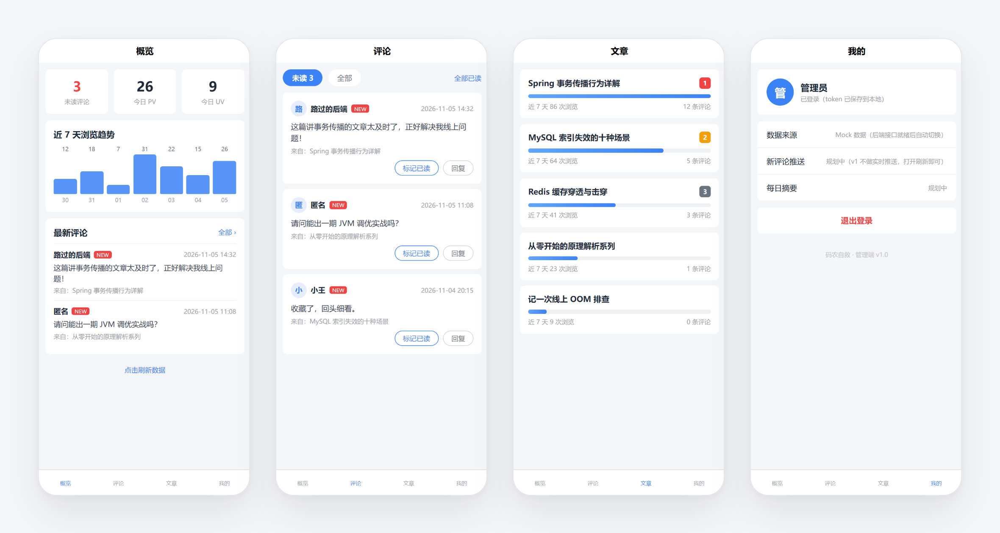
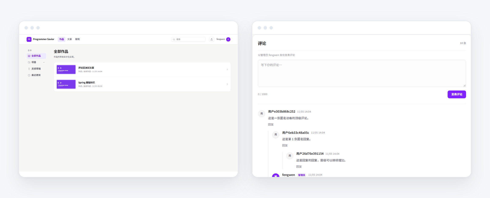
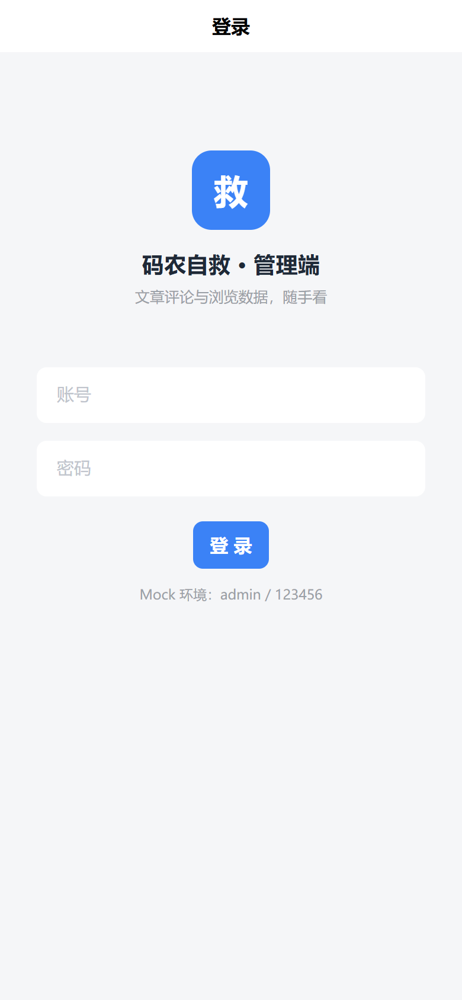
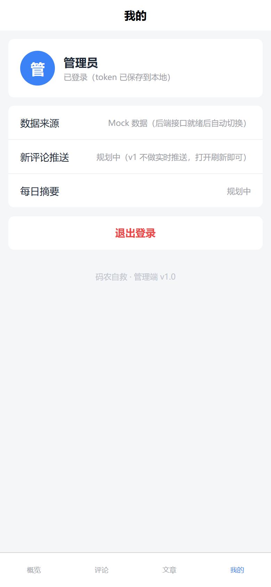
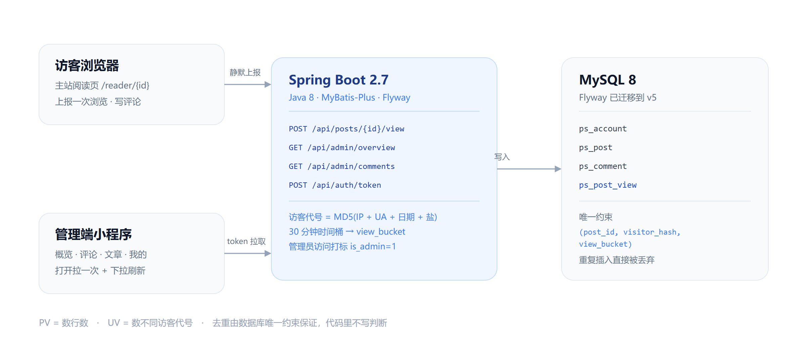

<div align="center">



# 码农自救

**Programmer Savior · 一个个人技术博客，和一个装在微信里的站长控制台。**

不用打开电脑，也能知道「有没有人看、有没有人留言」。


</div>

---

## 这是什么

本站由三个子项目组成，一套数据、两种终端：

| 子项目 | 是什么 | 谁在用 |
| --- | --- | --- |
| `programmerSavior` | 博客主站，React 单页应用。上传 HTML 文章、按目录浏览、阅读页带无限层级评论 | 访客 |
| `programmerSaviorBackend` | 后端服务。账号登录、文章上传与解析、评论读写、（规划中）浏览统计 | 两端共用 |
| `programmerSaviorMiniapp` | 管理端微信小程序。概览、评论、文章、我的四个 Tab | 站长本人 |

## 产品设计

### 一句话定位

> 让站长在手机上用 **30 秒**完成三件事：发现新评论、判断今天有没有人看、决定要不要回复。

### 只回答三个问题

打开小程序第一屏，就是三个数字：

| 数字 | 回答的问题 | 口径 |
| --- | --- | --- |
| **未读评论** | 有没有事要处理 | `created_at > last_seen_at`，进一次评论区即清零 |
| **今日 PV** | 今天有没有人看 | 当天有效浏览数（去重后） |
| **今日 UV** | 来了几个人 | 当天不同访客代号的数量 |

### 「有效 PV」怎么算

这是整个项目里唯一需要仔细定义的地方，口径先钉死再写代码：

- **一次有效浏览** = 阅读页成功拿到文章数据后上报一次，路由切换、预加载都不算；
- **30 分钟内同一访客看同一篇只算一次** —— 用固定时间桶 + 数据库唯一约束实现，不是代码里 `if` 判断；
- **管理员访问照常入库但打标** `is_admin=1`，统计时排除，自己刷不会污染数据；
- **爬虫 UA 直接丢弃**，不落库。

代价是 12:29 和 12:31 会算两次（跨桶），对个人站完全可接受，换来的是**并发下也不会算错**。

### MVP 只做四个 Tab

| Tab | 干什么 | 不做什么 |
| --- | --- | --- |
| 概览 | 三个核心数字、近 7 天趋势、最新评论直达 | 不做复杂漏斗、在线人数 |
| 评论 | 未读优先、单条标记已读、一键全部已读、下拉刷新 | 不删评论、不做敏感词后台 |
| 文章 | 每篇近 7 天浏览量 + 热度排名 | 不在手机上传/编辑文章 |
| 我的 | 登录态、数据来源、退出登录 | 不做多管理员、权限角色 |

**明确不做**：手机端写文章、实时推送（SSE/WebSocket）、日聚合统计表、多管理员协作。个人站一天几十 PV，这些都属于「先加上去再也没用过」的功能。

## 界面

**主站**：上传 HTML 即发布，标题与首图自动提取；文章用 `sandbox` iframe 隔离渲染，评论区支持无限层级回复，直接回复超过 5 条自动折叠。

<div align="center">

</div>

**管理端**：四个 Tab 覆盖全部日常操作，登录用账号密码换 token，存本地，过期自动回登录页。

<div align="center">
<table>
<tr>
<td align="center"></td>
<td align="center"></td>
</tr>
<tr>
<td align="center"><sub>账号密码换 token</sub></td>
<td align="center"><sub>数据来源、推送开关、退出</sub></td>
</tr>
</table>
</div>

## 技术架构

<div align="center">

</div>

### 技术栈

| 层 | 选择 | 为什么是它 |
| --- | --- | --- |
| 主站前端 | React 19 · TypeScript 7 · Vite 8 · React Router 7 · Tailwind 4 | 路由驱动页面，每个菜单一个 URL；风格参考 Lemon Squeezy，白底 + 淡紫强调 |
| 后端 | Java 8 · Spring Boot 2.7.18 · MyBatis-Plus 3.5.7 | 2.7 是最后一个支持 Java 8 的版本，环境所限 |
| 数据库 | MySQL 8 · Flyway · BCrypt · Jsoup | 迁移可追溯；密码不外露；上传 HTML 自己解析标题/首图/正文 |
| 管理端 | 原生微信小程序（WXML / WXSS / JS） | 不引框架，包体最小，`onShow` + 下拉刷新即可满足需求 |
| 鉴权 | 主站 Session Cookie · 小程序 `X-Admin-Token` | 小程序没有 cookie 语义，必须有一条 token 分支 |

### 四个关键决策

1. **存事件，不存计数器。** 一次浏览 = 插入一行 `ps_post_view`，带访客代号和 30 分钟桶号。表上有唯一约束 `(post_id, visitor_hash, view_bucket)`，重复插入被数据库直接丢弃（`INSERT IGNORE`）。于是 **PV = 数行数，UV = 数不同代号**，没有计数器、没有加锁、没有防刷代码。
2. **时间桶只负责去重，日期只负责归属。** `view_bucket` 用 UTC epoch（无时区歧义），「今天」用 `created_at`（东八区）过滤。两个职责分开，不会出现跨天 PV 和 UV 对不上的经典问题。
3. **管理端是状态面板，不是缩小版 CMS。** 手机上不做上传、编辑、删除。任何操作都要能在一次点击内完成，未读状态要能一个动作清零。
4. **小程序不用 uni-app，改原生。** 预览环境无法加载 uni-app 的 Vue 运行时（`_export_sfc` 在 vendor 尾部，执行中断就没了），继续调框架属于和工具链搏斗。原生 WXML 一套写完，包体更小、启动更快，反而更省事。

## 数据模型

| 表 | 作用 | 关键字段 |
| --- | --- | --- |
| `ps_account` | 管理员账号 | `username`、`password`（BCrypt）、`last_seen_at`（未读水位线） |
| `ps_post` | 文章 | `title`、`section_id` / `menu_id`（三级目录）、`route_path`、`html_content`、`plain_text`、`image_url` |
| `ps_comment` | 评论 | `post_id`、`parent_id`（自关联，无限层级）、`author_name`、`author_is_admin`、`ip_hash` |
| `ps_post_view` | 浏览事件 | `visitor_hash`、`view_bucket`、`is_admin`、唯一约束去重 |

访客代号 = `MD5(IP + UA + 日期 + 服务端盐)`。日期入哈希让 UV 天然按天成立；盐放配置，重启不会让全站访客「变成新人」。

## 目录结构

```text
dsh_work/
├── programmerSavior/            # 主站前端（React 19 + Vite）
├── programmerSaviorBackend/     # 后端（Spring Boot 2.7 + Flyway 迁移 SQL）
├── programmerSaviorMiniapp/
│   ├── native/                  # 管理端小程序源码（原生，当前使用）
│   ├── src/                     # 同款界面的 uni-app 版本（保留备选）
│   └── scripts/                 # 同步与自检脚本
├── docs/images/                 # README 用图
├── admin-mini-program-plan.md   # 产品规划原文
└── spring-basics.html           # 配套学习资料
```

## 快速开始

```bash
# 1. 后端（默认连本机 MySQL: mock_prod_db，启动时 Flyway 自动建表/升级）
cd programmerSaviorBackend
mvnw.cmd spring-boot:run                 # Windows
./mvnw spring-boot:run                   # Git Bash / macOS
# 若 shell 里已有 SERVER_PORT 环境变量（会覆盖配置文件），显式指定：
SERVER_PORT=8080 ./mvnw spring-boot:run

# 2. 主站前端
cd programmerSavior
npm install && npm run dev               # 默认 http://localhost:5173

# 3. 管理端小程序
cd programmerSaviorMiniapp
npm run dev:h5                           # 浏览器预览（手机尺寸），账号 admin / 123456
npm run mp:check                         # 离线自检：语法 / JSON / 四页数据冒烟
npm run build:mp-weixin                  # 同步到 dist/build/mp-weixin，导入微信开发者工具
```

> 小程序目前 `native/utils/config.js` 里 `USE_MOCK: true`，跑的是本地假数据（存在 Storage 里，标记已读会真实生效）。后端统计接口接完后改成 `false` 即可切真数据。

## 当前进度

| 模块 | 状态 |
| --- | --- |
| 主站前端 + 后端（登录 / 上传 / 阅读 / 评论） | 已完成 |
| 管理端小程序四个 Tab + 登录 + Mock 数据 | 已完成（H5 预览验证） |
| `ps_post_view` 表 + `last_seen_at` 水位线 | 迁移 V4 / V5 已执行 |
| 浏览上报接口 / admin 查询接口 / token 登录 | 开发中 |
| 通知推送、Android 打包、PWA 离线 | 未开始 |

## 已知限制

- **匿名身份可伪造**：`X-Forwarded-For` 取首值，客户端可自填，只影响 UV 轻微虚增，个人站接受此风险；
- **登录无频率限制**：`/api/auth/login` 可被暴力尝试，上线前应加限流；
- **列表无分页**：文章与评论全量返回，数据量大了会变重；
- **无自动化测试**：目前只有小程序侧的离线自检脚本；
- **小程序上线需备案**：request 合法域名必须是 HTTPS 且已 ICP 备案，开发阶段可在调试模式下直连本机。

## 文档

- [产品规划](admin-mini-program-plan.md) —— 形态选型、指标体系、接口设计、迭代计划与风险清单
- [后端说明](programmerSaviorBackend/README.md) —— 数据库配置、接口约定、启动方式
- [主站前端说明](programmerSavior/README.md) —— 页面结构、交互细节、截图

---

<div align="center"><sub>写代码是为了少加班，写博客是为了少踩坑。</sub></div>
