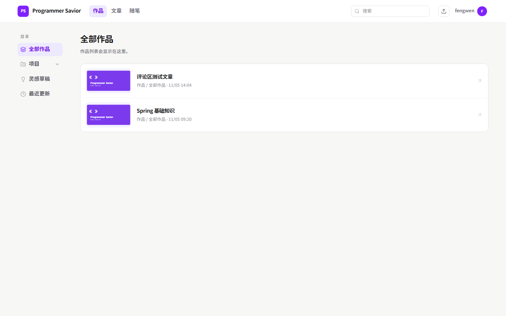
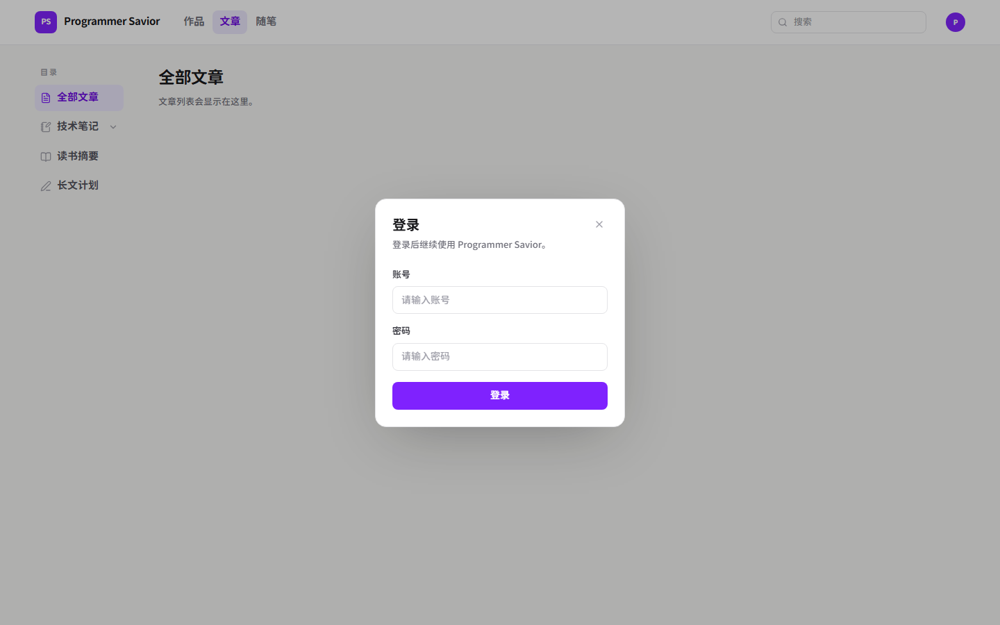
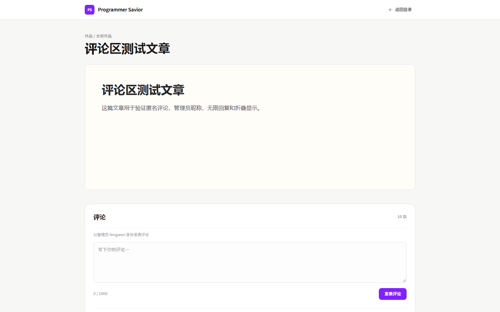
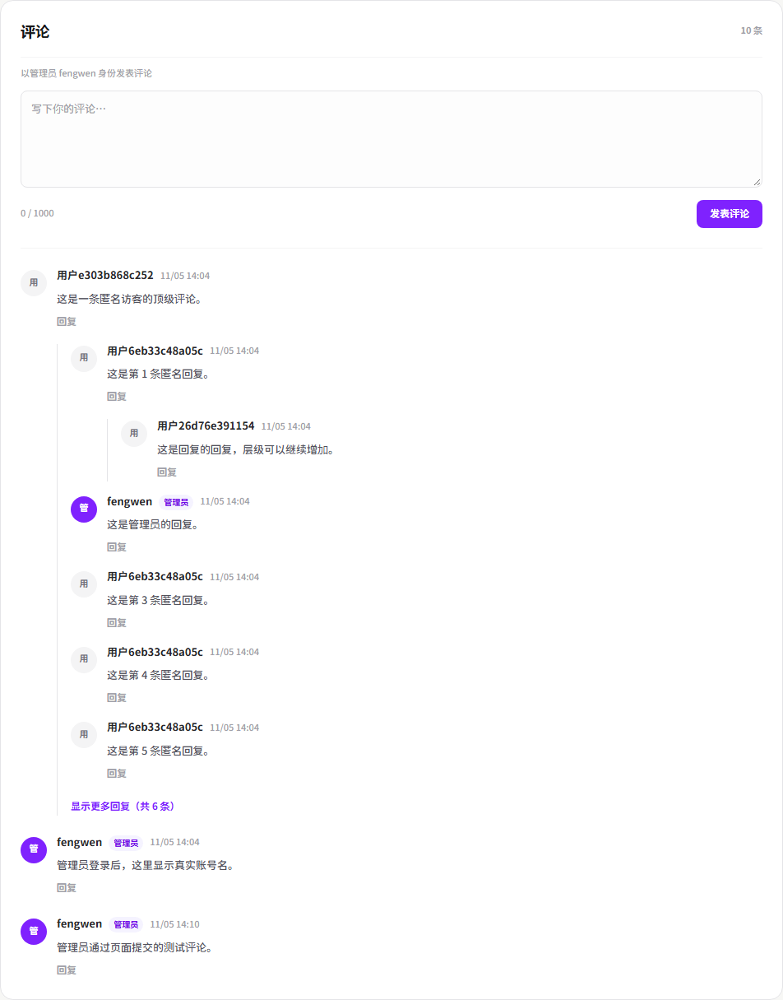

# Programmer Savior

一个管理「作品 / 文章 / 随笔」的前端应用，配套一个 Java 8 + Spring Boot 后端。

前端使用 **React Router**：每个叶子菜单对应一个独立 URL 和一个独立页面文件。页面默认只有标题和文字占位；登录后可以上传 HTML，上传成功后会显示为紧凑列表，点击某一项在新标签页进入独立阅读页和评论区。



## 已实现

- 顶栏：品牌、搜索框、一级目录、登录后的上传图标和账号菜单
- 一级目录：作品、文章、随笔；直接切换对应路由
- 左侧栏：距屏幕边缘 50px、宽 128px，与内容区间隔 50px
- 侧边菜单：一级菜单带图标；二级菜单默认折叠，点击子项进入对应路由
- 页面：每个路由一个独立文件，默认显示标题和文字占位
- 登录 / 退出：点击右上角头像登录；登录后头像变成账号菜单，可退出登录
- 上传：登录后显示上传图标，选择一 / 二 / 三级目录并上传 HTML
- 内容展示：作品、文章、随笔以紧凑列表展示，缩略图在左、标题和目录在右
- 阅读页：点击列表项在新标签页打开，不带主站侧栏，文章 HTML 用 sandbox iframe 隔离
- 评论：每篇文章底部可评论，支持无限层级回复；直接回复超过 5 条时折叠，点击后全部展开
- 评论身份：未登录用户使用“用户 + IP MD5 前 12 位”的昵称；管理员登录后显示真实账号名
- 响应式：桌面端左右分栏，移动端菜单改为两列网格
- 搜索框仍为 UI 占位

视觉上参考了 [Lemon Squeezy](https://www.tailwindcss.cn/showcase/lemon-squeezy) 的克制风格：白底、淡紫色强调、圆体粗字，不使用渐变和大面积装饰。

## 技术栈

| 用途 | 选择 | 说明 |
| --- | --- | --- |
| 框架 | React 19 | 组件化 |
| 语言 | TypeScript 7 | 类型检查 |
| 构建工具 | Vite 8 | 启动和打包 |
| 路由 | React Router 7 | URL 驱动页面与菜单选中状态 |
| 样式 | Tailwind CSS 4 | 原子化样式 |
| 图标 | Lucide React | 统一图标 |
| 字体 | Swei Gothic | 圆润粗体，本地子集化 |
| 后端 | Java 8 + Spring Boot 2.7 | 登录、上传、评论和 Session |
| HTML 解析 | Jsoup | 提取标题、首图和正文文本 |
| 数据库 | MySQL 8 + Flyway + MyBatis-Plus | `ps_account`、`ps_post`、`ps_comment` |
| 包管理 | pnpm 10 | 前端依赖管理 |

字体来源：[Swei Gothic](https://github.com/Cloudfonts/swei-gothic)，许可证见 [OFL.txt](src/assets/fonts/OFL.txt)。

## 快速开始

前端和后端分别位于同级目录：

```text
D:\dsh_work\
├─ programmerSavior/         前端
└─ programmerSaviorBackend/  后端
```

前端环境要求：Node.js 22+、pnpm 10+。
后端环境要求：JDK 8、Maven 3.9.9（或项目自带的 Maven Wrapper）、MySQL 8。

先启动后端：

```bash
cd ../programmerSaviorBackend

# Windows
mvnw.cmd spring-boot:run

# macOS / Linux
./mvnw spring-boot:run
```

后端默认运行在 `http://localhost:8080`，启动说明和数据库配置见 [后端 README](../programmerSaviorBackend/README.md)。

再启动前端：

```bash
cd programmerSavior
pnpm install
pnpm dev
```

打开终端提示的地址，默认是 `http://localhost:5173`。前端的 `/api` 请求会由 Vite 代理到后端 8080 端口。

其他命令：

```bash
pnpm build    # 类型检查 + 生产构建，产物在 dist/
pnpm preview  # 本地预览构建产物
pnpm lint     # Oxlint 代码检查
```

## 登录

点击右上角头像会打开登录弹窗，弹窗只提供账号密码登录，没有注册和找回密码。

```text
账号：fengwen
密码：fengwenpsd
```



登录流程：

1. 前端提交 `POST /api/auth/login`。
2. 后端在 `ps_account` 表中按账号查询，并用 BCrypt 校验密码。
3. 登录成功后，后端把账号 id 写入 `HttpSession`，浏览器保存 `JSESSIONID` Cookie。
4. 前端刷新页面时调用 `GET /api/auth/me` 恢复登录状态，右上角显示账号名。
5. 未登录或登录失效时返回 401，前端保持未登录状态。

登录后点击头像会打开账号菜单，菜单中的“退出登录”调用 `POST /api/auth/logout`，
后端销毁 Session，前端同步清空账号、上传入口和登录态。

后端数据库使用本机可用的 `mock_prod_db`，表名为 `ps_account`、`ps_post` 和 `ps_comment`，字符集 `utf8mb4`、排序规则 `utf8mb4_general_ci`。数据库不会保存明文密码。

开发环境代理配置在 [`vite.config.ts`](vite.config.ts)：

```ts
server: {
  proxy: {
    '/api': {
      target: 'http://127.0.0.1:8080',
      changeOrigin: true,
      xfwd: true,
    },
  },
},
```

`xfwd: true` 会把客户端 IP 放进 `X-Forwarded-For`，后端用它生成匿名评论昵称。正式部署时反向代理也要正确设置该请求头。

## 上传 HTML

登录后，账号旁边会出现一个上传图标。点击后选择一个 HTML 文件，并依次选择一级、二级、三级目录；上传成功后会自动跳到对应路由，以紧凑列表展示内容。


点击任意列表项后，会在浏览器新标签页打开独立阅读页。缩略图只显示在列表中，阅读页顶部不会重复显示封面。



处理流程：

1. 前端校验扩展名（`.html` / `.htm`）和大小（不超过 2MB）。
2. 文件连同目录 id、目录名称和路由一起提交到后端。
3. 后端用 Jsoup 解析标题、第一张图片和正文纯文本。
4. 原始 HTML、纯文本、标题、封面和目录信息一起保存到 `ps_post`。
5. 前端回到目标路由，按路径拉取内容并显示为紧凑列表。
6. 点击列表项时进入 `/reader/{id}`，加载文章和评论区。

解析规则：

- 标题：`<title>` → `<h1>` → 文件名
- 首图：第一个绝对 `http(s)` 图片地址；否则使用默认封面 [`default-cover.svg`](public/default-cover.svg)
- 正文：保存原始 HTML，同时额外保存一份 `body.text()` 纯文本，方便以后搜索
- 展示：文章放进 `sandbox=""` 的 iframe，上传页面里的脚本不会影响主应用
- 封面：只出现在列表缩略图，不在阅读页顶部重复展示

对应接口：

```text
POST /api/posts             （需要登录，multipart/form-data）
GET  /api/posts?path=/works/projects/active
GET  /api/posts/{id}        （阅读页详情）
```

上传记录会显示在所选路由下，多条记录按创建时间倒序排列。

## 评论

每篇文章底部都有评论区，阅读页无需登录也能评论。评论和回复都保存到 `ps_comment`，通过 `parentId` 支持任意层级回复。



### 匿名昵称

- 后端读取 `X-Forwarded-For` 的第一个地址；取不到时使用连接地址。
- 对 IP 做 MD5，取前 12 位，拼成 `用户 + 12 位哈希`，例如 `用户e303b868c252`。
- 数据库只保存 IP 的 MD5，不保存原始 IP。
- 同一个 IP 会得到稳定昵称；不需要注册或登录。

### 管理员昵称

管理员登录后打开阅读页，评论区会识别 Session：

- 评论者显示真实账号名，例如 `fengwen`
- 旁边显示“管理员”标记
- 未登录访客发评论时仍使用 IP 匿名昵称

### 回复折叠

- 每条评论的直接回复超过 5 条时，默认只显示前 5 条
- 点击“显示更多回复（共 N 条）”后一次性展示全部
- 展开后可“收起回复”
- 递归层级本身不设上限

### 评论接口

```text
GET  /api/posts/{postId}/comments
POST /api/posts/{postId}/comments
```

发表评论请求：

```json
{
  "content": "评论内容",
  "parentId": null
}
```

`parentId` 为空表示顶级评论；填写某条评论的 id 表示回复它。评论只保存纯文本，前端按文本渲染，不执行 HTML。

## 路由结构

路由表在 [`src/router.tsx`](src/router.tsx)，`/` 会重定向到 `/works`。

```text
/                              → /works
/works                         全部作品
/works/projects                → /works/projects/active
/works/projects/active         进行中
/works/projects/done           已完成
/works/projects/archived       已归档
/works/drafts                  灵感草稿
/works/recent                  最近更新

/articles                      全部文章
/articles/notes                → /articles/notes/frontend
/articles/notes/frontend       前端
/articles/notes/backend        后端
/articles/notes/tools          工具
/articles/reading              读书摘要
/articles/longform             长文计划

/essays                        全部随笔
/essays/journal                日常记录
/essays/thoughts               随手想法
/essays/archive                → /essays/archive/2026
/essays/archive/2026           2026
/essays/archive/2025           2025
/essays/archive/earlier        更早

/reader/:postId                独立阅读页（新标签页）
*                              404
```

项目使用 `createBrowserRouter`。部署到静态服务器时，需要把未知路径回退到 `index.html`，否则直接刷新子路由会 404。

## 页面文件

每个路由都对应一个页面文件：

```text
src/pages/
├─ works/
│  ├─ WorksAllPage.tsx
│  ├─ WorksActivePage.tsx
│  ├─ WorksDonePage.tsx
│  ├─ WorksArchivedPage.tsx
│  ├─ WorksDraftsPage.tsx
│  └─ WorksRecentPage.tsx
├─ articles/
│  ├─ ArticlesAllPage.tsx
│  ├─ ArticlesFrontendPage.tsx
│  ├─ ArticlesBackendPage.tsx
│  ├─ ArticlesToolsPage.tsx
│  ├─ ArticlesReadingPage.tsx
│  └─ ArticlesLongformPage.tsx
├─ essays/
│  ├─ EssaysAllPage.tsx
│  ├─ EssaysJournalPage.tsx
│  ├─ EssaysThoughtsPage.tsx
│  ├─ EssaysArchive2026Page.tsx
│  ├─ EssaysArchive2025Page.tsx
│  └─ EssaysArchiveEarlierPage.tsx
├─ ReaderPage.tsx
└─ NotFoundPage.tsx
```

页面目前统一使用 [`PagePlaceholder`](src/components/PagePlaceholder.tsx)，有上传内容时自动显示为紧凑列表：

```tsx
export default function WorksAllPage() {
  return (
    <PagePlaceholder
      title="全部作品"
      description="作品列表会显示在这里。"
    />
  )
}
```

需要真实内容时，只改这个文件即可。

## 从零搭建

### 1. 创建项目

```bash
pnpm create vite@latest programmerSavior --template react-ts
cd programmerSavior
```

### 2. 安装依赖

```bash
pnpm add tailwindcss @tailwindcss/vite lucide-react react-router-dom
```

### 3. 配置 Vite

`vite.config.ts`：

```ts
import tailwindcss from '@tailwindcss/vite'
import react from '@vitejs/plugin-react'
import { defineConfig } from 'vite'

export default defineConfig({
  plugins: [react(), tailwindcss()],
  server: {
    proxy: {
      '/api': {
        target: 'http://127.0.0.1:8080',
        changeOrigin: true,
        xfwd: true,
      },
    },
  },
})
```

Tailwind CSS 4 通过 Vite 插件接入，不需要额外的 `tailwind.config.js`。

### 4. 引入 Tailwind

`src/index.css` 第一行：

```css
@import "tailwindcss";
```

再按需加入字体、页面背景和基础样式，完整内容见 [`src/index.css`](src/index.css)。

### 5. 建路由和布局

- [`src/router.tsx`](src/router.tsx)：集中声明 URL 和页面组件。
- [`src/App.tsx`](src/App.tsx)：布局路由，渲染顶栏、侧栏和 `<Outlet />`。
- [`src/main.tsx`](src/main.tsx)：用 `<RouterProvider />` 接管应用。
- [`src/data/navigation.ts`](src/data/navigation.ts)：顶栏、侧栏和路径的共享数据。

添加一个新页面只需要三步：

1. 在 `src/pages/` 下新建页面文件。
2. 在 `navigation.ts` 的对应菜单项上补充 `path`。
3. 在 `router.tsx` 中把该路径指向新页面。

## 项目结构

```text
programmerSavior/
├─ docs/
│  ├─ comments.png
│  ├─ login.png
│  ├─ preview.png
│  ├─ upload-result.png
│  ├─ upload.png
│  └─ viewer.png
├─ public/
│  ├─ default-cover.svg
│  └─ favicon.svg
├─ src/
│  ├─ api/
│  │  ├─ auth.ts
│  │  ├─ comments.ts
│  │  ├─ http.ts
│  │  └─ posts.ts
│  ├─ assets/
│  │  └─ fonts/
│  ├─ components/
│  │  ├─ CommentsSection.tsx
│  │  ├─ LoginModal.tsx
│  │  ├─ PagePlaceholder.tsx
│  │  ├─ Sidebar.tsx
│  │  ├─ TopBar.tsx
│  │  └─ UploadModal.tsx
│  ├─ data/
│  │  └─ navigation.ts
│  ├─ hooks/
│  │  └─ useScrollLock.ts
│  ├─ pages/
│  │  ├─ works/
│  │  ├─ articles/
│  │  ├─ essays/
│  │  ├─ ReaderPage.tsx
│  │  └─ NotFoundPage.tsx
│  ├─ App.tsx
│  ├─ index.css
│  ├─ main.tsx
│  └─ router.tsx
├─ index.html
├─ package.json
├─ tsconfig.json
├─ tsconfig.app.json
├─ tsconfig.node.json
├─ vite.config.ts
└─ README.md
```

## 想改哪里？

| 需求 | 文件 |
| --- | --- |
| 修改 URL、重定向或 404 规则 | `src/router.tsx` |
| 修改单个页面内容 | `src/pages/` 下对应文件 |
| 修改一级目录、侧边菜单或路径 | `src/data/navigation.ts` |
| 修改顶栏 | `src/components/TopBar.tsx` |
| 修改登录弹窗 | `src/components/LoginModal.tsx` |
| 修改上传弹窗 | `src/components/UploadModal.tsx` |
| 修改登录 / 上传请求和错误处理 | `src/api/auth.ts`、`src/api/posts.ts` |
| 修改紧凑列表 | `src/components/PagePlaceholder.tsx` |
| 修改阅读页布局 | `src/pages/ReaderPage.tsx` |
| 修改评论、回复和折叠逻辑 | `src/components/CommentsSection.tsx` |
| 修改评论接口 | `src/api/comments.ts` |
| 修改弹窗滚动锁和抖动补偿 | `src/hooks/useScrollLock.ts` |
| 修改侧边栏与折叠逻辑 | `src/components/Sidebar.tsx` |
| 修改全局页面占位样式 | `src/components/PagePlaceholder.tsx` |
| 修改字体、背景、选中颜色 | `src/index.css` |
| 修改整体布局 | `src/App.tsx` |

## 当前边界

- 没有上传内容时，页面只显示标题和说明
- 搜索框只有 UI，输入框为 `readOnly`
- 登录和退出已实现，但没有注册、验证码和登录限流
- 没有编辑、删除上传内容，也没有分页
- 评论没有编辑、删除、敏感词过滤和频率限制
- 文章 HTML 在 `sandbox=""` iframe 中展示，脚本不会执行
- 使用 Browser Router，部署时需要配置 SPA fallback

## 下一步

1. 增加上传内容的编辑、删除和分页。
2. 从上传内容中提取摘要和标签，接入搜索。
3. 增加评论审核、删除和简单频率限制。
4. 将外部首图转存到自己的对象存储。
5. 使用 Vitest + Testing Library 覆盖路由、登录、上传和评论流程。

---

快速预览：`pnpm install && pnpm dev`。
